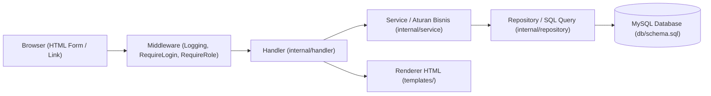
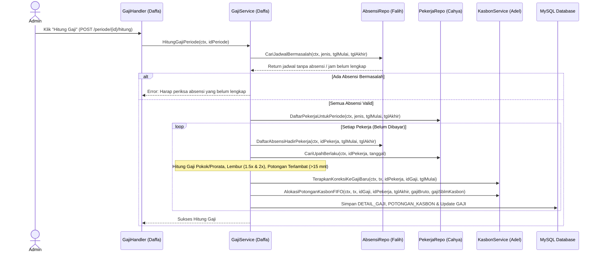

# Panduan Teknis & Taktis Pengerjaan Proyek (Blueprint Kelompok 3)
## Sistem Penggajian Pekerja Harian dan Shift — Konveksi Mitra Jaya

Dokumen ini adalah panduan teknis dan taktis lengkap yang menerjemahkan:
- **Studi Kasus Utama:** `Topik Project Akhir Web Programming.md`
- **Dokumen Rancangan & ERD:** `plan/Project Persiapan Tahap 1 Kelompok 3_nawaitu.docx`
- **Pembagian Tugas Tim:** `README.md`
- **Skema Database:** `db/schema.sql`

Setiap anggota kelompok wajib membaca bagian **Standar Arsitektur Tim** (Bab 1) dan **Spesifikasi Modul Masing-Masing** (Bab 2), serta memperhatikan **Kontrak Integrasi Antar-Modul** (Bab 3) agar kode tidak bentrok saat digabungkan (`git merge`).

---

## Daftar Anggota & Tanggung Jawab Vertikal (Full-Stack)

| No | Nama Anggota | NIM | Peran & Modul | Tabel Database Utama |
| :-: | :--- | :---: | :--- | :--- |
| **1** | **Muhammad Naufal A.** *(Ketua)* | 2404130057 | Setup Core, Schema SQL, Auth (`bcrypt` + Session Cookie), Middleware Role, Layout & Integrasi | `pengguna`, `sesi` |
| **2** | **Cahya Din Ramadhan** | 2404130018 | Modul Master Pekerja (`harian`/`bulanan`) & Riwayat Upah (AB 02) | `pekerja`, `riwayat_upah` |
| **3** | **Muhammad Falih A.** | 2404130054 | Modul Master Shift, Jadwal Shift & Pencatatan/Validasi Absensi (AB 03, AB 06, AB 07) | `shift`, `jadwal_shift`, `absensi` |
| **4** | **Daffa Azmi Ikhtiar F.** | 2404130059 | Modul Periode Gaji, Engine Hitung Gaji/Lembur/Prorata, Pembayaran & Tutup Periode (AB 01, AB 04, AB 05, AB 09, AB 10) | `periode_gaji`, `gaji`, `detail_gaji` |
| **5** | **Adel Bin Faris Abdat** | 2404130169 | Modul Kasbon (FIFO Maks 30%), Koreksi Antarperiode, Slip Gaji & Laporan Rekap (AB 08, AB 11) | `kasbon`, `potongan_kasbon`, `koreksi_gaji` |

---

# BAB 1 — Arsitektur Aplikasi & Standar Coding Tim

## 1.1 Pola Arsitektur Berlapis (`go-class`)
Proyek ini menggunakan standar arsitektur Go bawaan kelas tanpa framework eksternal (murni `net/http` Go 1.22+ routing dan `database/sql`):



Aturan penting setiap layer:
1. **`internal/model`**: Hanya berisi definisi `struct`, konstanta status/role, dan error standar (`ErrNotFound`, dll).
2. **`internal/repository`**: Hanya berisi query SQL (`SELECT`, `INSERT`, `UPDATE`) menggunakan `*sql.DB` atau `*sql.Tx`. **Dilarang** menaruh rumus bisnis di sini.
3. **`internal/service`**: Tempat seluruh **Aturan Bisnis (AB 01 – AB 11)** dan validasi input (`ValidasiError`).
4. **`internal/handler`**: Membaca request form/path/query parameter, memanggil `service`, dan me-render template HTML atau melakukan `http.Redirect`.

---

## 1.2 Struktur Direktori Lengkap Target Akhir

Agar tidak ada file yang saling menimpa di Git, setiap anggota hanya membuat/mengedit file sesuai daftar berikut:

```text
Konveksi Mitra Jaya/
├── .env
├── go.mod
├── cmd/
│   └── web/
│       └── main.go                     # [Naufal] Perakitan semua repo, service, handler, dan routing
├── db/
│   └── schema.sql                      # [Naufal] DDL 13 tabel + seeder awal
├── internal/
│   ├── config/
│   │   └── config.go                   # [Naufal] Load ADDR, DB_DSN, COOKIE_SECURE
│   ├── middleware/
│   │   ├── logging.go                  # [Naufal] Log HTTP request
│   │   └── auth.go                     # [Naufal] LoadSession, RequireLogin, RequireRole
│   ├── model/
│   │   ├── produk.go                   # (Bawaan template)
│   │   ├── pengguna.go                 # [Naufal] Struct Pengguna & Sesi
│   │   ├── pekerja.go                  # [Cahya] Struct Pekerja & RiwayatUpah
│   │   ├── absensi.go                  # [Falih] Struct Shift, JadwalShift, Absensi
│   │   ├── gaji.go                     # [Daffa] Struct PeriodeGaji, Gaji, DetailGaji
│   │   └── kasbon.go                   # [Adel] Struct Kasbon, PotonganKasbon, KoreksiGaji, RekapLaporan
│   ├── repository/
│   │   ├── produk.go                   # (Bawaan template)
│   │   ├── pengguna.go                 # [Naufal] Query tabel pengguna & sesi
│   │   ├── pekerja.go                  # [Cahya] Query tabel pekerja & riwayat_upah
│   │   ├── absensi.go                  # [Falih] Query tabel shift, jadwal_shift, absensi
│   │   ├── gaji.go                     # [Daffa] Query tabel periode_gaji, gaji, detail_gaji
│   │   └── kasbon.go                   # [Adel] Query tabel kasbon, potongan_kasbon, koreksi_gaji, laporan
│   ├── service/
│   │   ├── produk.go                   # (Bawaan template & definisi ValidasiError)
│   │   ├── auth.go                     # [Naufal] Logika Login, Register, Logout, bcrypt
│   │   ├── pekerja.go                  # [Cahya] Validasi Pekerja & Riwayat Upah (AB 02)
│   │   ├── absensi.go                  # [Falih] Validasi Jadwal & Hitung Terlambat/Lembur (AB 03, 06, 07)
│   │   ├── gaji.go                     # [Daffa] Engine Hitung Gaji, Prorata, Bayar & Tutup Periode
│   │   └── kasbon.go                   # [Adel] Logika Kasbon FIFO 30%, Koreksi Gaji & Rekap Laporan
│   └── handler/
│       ├── render.go                   # [Naufal] Registrasi semua file template & helper fungsi
│       ├── halaman.go                  # [Naufal] Dashboard Beranda
│       ├── auth.go                     # [Naufal] Handler /login, /register, /logout
│       ├── pekerja.go                  # [Cahya] Handler /pekerja/*
│       ├── absensi.go                  # [Falih] Handler /shift/*, /jadwal/*, /absensi/*
│       ├── gaji.go                     # [Daffa] Handler /periode/*, /gaji/*
│       └── kasbon.go                   # [Adel] Handler /kasbon/*, /koreksi/*, /laporan/*
└── templates/
    ├── layout.html                     # [Naufal] Kerangka utama HTML & CSS
    ├── header.html                     # [Naufal] Info user login & tombol Logout
    ├── sidebar.html                    # [Naufal] Navigasi menu sesuai Role
    ├── footer.html                     # [Naufal] Footer
    ├── home.html                       # [Naufal] Ringkasan dashboard
    ├── auth/                           # [Naufal] login.html, register.html
    ├── pekerja/                        # [Cahya] list.html, form.html, detail.html
    ├── absensi/                        # [Falih] jadwal_list.html, jadwal_form.html, absensi_form.html, pemeriksaan.html
    ├── gaji/                           # [Daffa] periode_list.html, periode_form.html, periode_detail.html, gaji_detail.html
    └── kasbon/                         # [Adel] kasbon_list.html, kasbon_form.html, koreksi_list.html, koreksi_form.html, slip.html, rekap.html
```

---

## 1.3 Aturan Tipe Data Uang & Pembulatan (Sesuai Bab 2.2 Dokumen)

Berdasarkan bagian **Asumsi Awal Perhitungan** pada dokumen rancangan:
1. **Penyimpanan Database:** Semua kolom nominal uang di MySQL menggunakan `DECIMAL(15, 2)` dan durasi jam lembur menggunakan `DECIMAL(6, 2)`. Di Go, gunakan `float64` untuk perhitungan antara, lalu bulatkan sesuai aturan sebelum disimpan.
2. **Pembulatan Rupiah Terdekat (Half-Up):**
   - Nilai uang hasil akhir komponen gaji dibulatkan ke rupiah terdekat; pecahan `0,5` dibulatkan naik (`math.Round(val)` di Go membulatkan $\ge 0.5$ ke atas untuk bilangan positif).
   ```go
   // BulatkanRupiah membulatkan nilai desimal positif ke rupiah terdekat (0.5 dibulatkan naik)
   func BulatkanRupiah(val float64) float64 {
       return math.Floor(val + 0.5)
   }
   ```
3. **Pembulatan Batas 30% Kasbon (Round-Down / Floor — AB 08):**
   - Khusus batas maksimal potongan kasbon: $30\% \times \text{gaji\_bruto}$ **dibulatkan ke bawah ke rupiah**:
   ```go
   // BatasPotonganKasbon menghitung 30% gaji bruto dibulatkan ke bawah (AB 08)
   func BatasPotonganKasbon(gajiBruto float64) float64 {
       if gajiBruto <= 0 {
           return 0
       }
       return math.Floor(0.30 * gajiBruto)
   }
   ```

---

## 1.4 Matriks Hak Akses Pengguna (Bab 1.2 & Bab 2.1)

Sistem memiliki 3 peran pada kolom `pengguna.peran`:

| Fitur / Menu | `admin` | `pemilik` | `petugas_absensi` |
| :--- | :---: | :---: | :---: |
| Login & Logout | ✅ | ✅ | ✅ |
| Kelola Pekerja & Riwayat Upah | ✅ | ✅ *(Lihat/Kelola)* | ❌ *(Diblokir)* |
| Kelola Master Shift & Jadwal Shift | ✅ | ✅ | ✅ *(Lihat Jadwal)* |
| Input & Edit Absensi Harian (Periode Terbuka) | ✅ | ✅ | ✅ |
| Kelola Kasbon Pekerja | ✅ | ✅ | ❌ *(Diblokir)* |
| Buat Periode, Hitung Gaji & Catat Pembayaran | ✅ | ✅ | ❌ *(Diblokir)* |
| Input Pengajuan Koreksi Gaji | ✅ | ✅ | ❌ *(Diblokir)* |
| **Setujui Koreksi Gaji & Tutup Periode** (AB 10 & 11) | ✅ *(Jika mode demo)* / ❌ | ✅ **(Utama)** | ❌ *(Diblokir)* |
| Cetak Slip Gaji & Lihat Rekap Biaya Periode | ✅ | ✅ | ❌ *(Diblokir)* |

> **Catatan Implementasi Middleware:**
> - Buat middleware `RequireRole("admin", "pemilik")` untuk membungkus seluruh route `/pekerja`, `/periode`, `/gaji`, `/kasbon`, `/koreksi`, dan `/laporan`. Dengan demikian, `petugas_absensi` otomatis mendapat `403 Forbidden` jika mencoba membuka URL gaji secara paksa.
> - Khusus endpoint `POST /periode/{id}/tutup` dan `POST /koreksi/{id}/setujui`, dapat dibatasi untuk `pemilik` (atau `admin` & `pemilik` agar fleksibel saat pengujian).

---

# BAB 2 — Panduan Teknis & Taktis Per Anggota

---

## 👤 ANGGOTA 1: Muhammad Naufal A. (Ketua)
**Modul:** Setup Core, Database Schema, Autentikasi (`bcrypt` + Session), Middleware & Layout Utama

### A. Tabel Database yang Diurus
1. `pengguna` (`id_pengguna`, `username`, `password_hash`, `nama_lengkap`, `peran`, `aktif`, `created_at`, `updated_at`)
2. `sesi` (`token`, `id_pengguna`, `expired_at`, `created_at`)

### B. Spesifikasi Model (`internal/model/pengguna.go`)
```go
package model

import "time"

type PeranPengguna string

const (
	PeranAdmin      PeranPengguna = "admin"      // Admin Penggajian
	PeranSupervisor PeranPengguna = "supervisor" // Petugas Absensi / Supervisor Shift
	PeranPemilik    PeranPengguna = "pemilik"    // Pemilik Konveksi (Owner)
)

type Pengguna struct {
	ID           int64
	Username     string
	PasswordHash string
	NamaLengkap  string
	Peran        PeranPengguna
	Aktif        bool
	CreatedAt    time.Time
}

type Sesi struct {
	Token      string
	IDPengguna int64
	ExpiredAt  time.Time
	CreatedAt  time.Time
	Pengguna   Pengguna // Diisi saat JOIN sesi dengan pengguna
}
```

### C. Spesifikasi Repository (`internal/repository/pengguna.go`)
Method yang wajib disediakan:
1. `TambahPengguna(ctx, u model.Pengguna) (int64, error)`
   - Tangkap error MySQL kode `1062` (`Duplicate entry`) pada `username` dan kembalikan error spesifik `model.ErrUsernameSudahDipakai`.
2. `CariByUsername(ctx, username string) (model.Pengguna, error)`
   - Query: `SELECT id_pengguna, username, password_hash, nama_lengkap, peran, aktif, created_at FROM pengguna WHERE username = ? AND aktif = 1`
3. `SimpanSesi(ctx, s model.Sesi) error`
   - Query: `INSERT INTO sesi (token, id_pengguna, expired_at) VALUES (?, ?, ?)`
4. `CariSesiValid(ctx, token string) (model.Sesi, error)`
   - Query JOIN antara `sesi` dan `pengguna` dengan syarat `s.token = ? AND s.expired_at > NOW() AND p.aktif = 1`.
5. `HapusSesi(ctx, token string) error`
   - Query: `DELETE FROM sesi WHERE token = ?`

### D. Spesifikasi Service (`internal/service/auth.go`)
1. `Register(ctx, username, password, namaLengkap, peran)`:
   - Validasi: `username` minimal 4 karakter tanpa spasi, `password` minimal 8 karakter, `peran` harus valid (`admin`, `supervisor`, `pemilik`).
   - Hash password menggunakan `bcrypt.GenerateFromPassword([]byte(password), bcrypt.DefaultCost)`.
2. `Login(ctx, username, password) (model.Sesi, error)`:
   - Cari user via `CariByUsername`.
   - Bandingkan password dengan `bcrypt.CompareHashAndPassword`.
   - Buat token acak 32 byte (`crypto/rand` $\rightarrow$ `hex.EncodeToString` menghasilkan 64 karakter hex).
   - Set `expired_at = time.Now().Add(24 * time.Hour)`, simpan ke tabel `sesi`.
3. `Logout(ctx, token string) error`:
   - Panggil `HapusSesi(ctx, token)`.

### E. Middleware & Context (`internal/middleware/auth.go`)
1. Buat context key khusus untuk menyimpan `model.Pengguna` yang sedang login:
   ```go
   func PenggunaDariContext(ctx context.Context) (model.Pengguna, bool)
   ```
2. Middleware `RequireLogin(authSvc, next)`:
   - Baca cookie `session_token`. Jika tidak ada atau tidak valid di DB, redirect ke `GET /login`.
   - Jika valid, simpan `sesi.Pengguna` ke `r.Context()` dan lanjutkan ke `next.ServeHTTP`.
3. Middleware `RequireRole(roles ...model.PeranPengguna)`:
   - Ambil pengguna dari context. Cek apakah `pengguna.Peran` ada di daftar `roles`. Jika tidak, kirim `http.Error(w, "Akses ditolak: Anda tidak memiliki izin ke halaman ini", http.StatusForbidden)`.

### F. Update `internal/handler/render.go`
Agar template `header.html` dan `sidebar.html` selalu tahu siapa user yang sedang login (untuk menyembunyikan menu Gaji/Kasbon bagi `supervisor`), tambahkan method `TampilDenganUser(w, r, file, data)` atau sertakan `CurrentUser *model.Pengguna`, serta tambahkan helper fungsi format di `FuncMap`:
- `rupiahFloat(n float64) string` $\rightarrow$ memformat `float64` menjadi `"Rp150.000"`
- `tglIndo(t time.Time) string` $\rightarrow$ memformat tanggal menjadi `"02 Jan 2006"`

### G. Daftar Route Modul 1 (`cmd/web/main.go`)
| Method & Path | Handler | Akses |
| :--- | :--- | :--- |
| `GET /login` | `auth.FormLogin` | Publik |
| `POST /login` | `auth.ProsesLogin` | Publik |
| `GET /register` | `auth.FormRegister` | Publik / Admin |
| `POST /register` | `auth.ProsesRegister` | Publik / Admin |
| `POST /logout` | `auth.Logout` | Login (Semua Role) |
| `GET /{$}` | `halaman.Home` | Login (Semua Role) |

---

## 👤 ANGGOTA 2: Cahya Din Ramadhan
**Modul:** Master Pekerja & Riwayat Upah (Aturan Bisnis **AB 02**)

### A. Tabel Database yang Diurus
1. `pekerja` (`id_pekerja`, `nama`, `jenis_pekerja`, `jabatan`, `kontak`, `tanggal_masuk`, `tanggal_keluar`, `created_at`, `updated_at`)
2. `riwayat_upah` (`id_upah`, `id_pekerja`, `berlaku_mulai`, `nominal`, `keterangan`, `created_at`)

### B. Spesifikasi Model (`internal/model/pekerja.go`)
```go
package model

import "time"

type JenisPekerja string

const (
	PekerjaHarian  JenisPekerja = "harian"
	PekerjaBulanan JenisPekerja = "bulanan"
)

type Pekerja struct {
	ID            int64
	Nama          string
	JenisPekerja  JenisPekerja
	Jabatan       string
	Kontak        string
	TanggalMasuk  time.Time
	TanggalKeluar *time.Time // Pointer karena NULL jika masih aktif bekerja
	UpahTerbaru   float64    // Diisi untuk tampilan tabel daftar pekerja
	CreatedAt     time.Time
}

func (p Pekerja) MasihAktif() bool {
	return p.TanggalKeluar == nil
}

type RiwayatUpah struct {
	IDUpah       int64
	IDPekerja    int64
	BerlakuMulai time.Time
	Nominal      float64
	Keterangan   string
	CreatedAt    time.Time
}
```

### C. Spesifikasi Repository (`internal/repository/pekerja.go`)
1. `Semua(ctx, filterJenis string, hanyaAktif bool) ([]model.Pekerja, error)`
   - Mengambil daftar pekerja beserta nominal upah terakhirnya (menggunakan subquery `SELECT nominal FROM riwayat_upah WHERE id_pekerja = p.id_pekerja ORDER BY berlaku_mulai DESC, id_upah DESC LIMIT 1`).
2. `CariByID(ctx, id int64) (model.Pekerja, error)`
3. `TambahPekerjaDenganUpahAwal(ctx, p model.Pekerja, upahAwal float64, berlakuMulai time.Time, keterangan string) (int64, error)`
   - Gunakan transaksi database (`tx, err := r.DB.BeginTx(ctx, nil)`):
     1. `INSERT INTO pekerja (nama, jenis_pekerja, jabatan, kontak, tanggal_masuk, tanggal_keluar) VALUES (?, ?, ?, ?, ?, ?)`
     2. `INSERT INTO riwayat_upah (id_pekerja, berlaku_mulai, nominal, keterangan) VALUES (?, ?, ?, ?)` (default `berlaku_mulai = p.TanggalMasuk`).
   - Ini menjamin aturan ERD Bab 3.2: *"Riwayat upah harus tersedia sebelum gaji dihitung."*
4. `Ubah(ctx, p model.Pekerja) error`
   - Mengupdate data pekerja (`nama`, `jabatan`, `kontak`, `tanggal_masuk`, `tanggal_keluar`).
   - **Penting (Aturan Bisnis):** Tidak ada fitur `DELETE` pekerja! Jika pekerja berhenti, cukup isi `tanggal_keluar`.
5. `TambahRiwayatUpah(ctx, u model.RiwayatUpah) (int64, error)`
   - Menyimpan kenaikan/perubahan upah baru. Tangkap error MySQL `1062` jika tanggal `berlaku_mulai` sudah ada untuk pekerja tersebut.
6. `DaftarRiwayatUpah(ctx, idPekerja int64) ([]model.RiwayatUpah, error)`
   - Diurutkan `ORDER BY berlaku_mulai DESC, id_upah DESC`.
7. **[KONTRAK INTEGRASI UNTUK DAFFA] `CariUpahBerlaku(ctx, idPekerja int64, tanggal time.Time) (model.RiwayatUpah, error)`**
   - Sesuai **AB 02**: *"Tarif yang digunakan adalah riwayat upah terakhir yang tanggal berlakunya tidak melewati tanggal yang dihitung."*
   ```sql
   SELECT id_upah, id_pekerja, berlaku_mulai, nominal, COALESCE(keterangan, ''), created_at
   FROM riwayat_upah
   WHERE id_pekerja = ? AND berlaku_mulai <= ?
   ORDER BY berlaku_mulai DESC, id_upah DESC
   LIMIT 1
   ```
8. **[KONTRAK INTEGRASI UNTUK DAFFA] `DaftarRiwayatUpahDalamRentang(ctx, idPekerja int64, tglMulai, tglSelesai time.Time) ([]model.RiwayatUpah, error)`**
   - Digunakan oleh engine Daffa untuk mengecek apakah pekerja bulanan mengalami perubahan tarif upah di tengah bulan (**AB 05b**).

### D. Aturan Validasi di Service (`internal/service/pekerja.go`)
- `Nama` dan `Jabatan` wajib diisi.
- `JenisPekerja` harus `'harian'` atau `'bulanan'`.
- Jika `TanggalKeluar != nil`, validasi `TanggalKeluar >= TanggalMasuk`.
- `Nominal` harus $> 0$.

### E. Daftar Route & Template Modul 2
| Method & Path | Handler | Template HTML |
| :--- | :--- | :--- |
| `GET /pekerja` | `pekerja.Daftar` | `templates/pekerja/list.html` |
| `GET /pekerja/form` | `pekerja.FormTambah` | `templates/pekerja/form.html` |
| `POST /pekerja` | `pekerja.Simpan` | Redirect ke `/pekerja` |
| `GET /pekerja/{id}` | `pekerja.Detail` | `templates/pekerja/detail.html` *(Tabel info pekerja + Tabel riwayat upah + Form tambah upah baru)* |
| `GET /pekerja/{id}/edit` | `pekerja.FormEdit` | `templates/pekerja/form.html` |
| `POST /pekerja/{id}/edit` | `pekerja.Update` | Redirect ke `/pekerja/{id}` |
| `POST /pekerja/{id}/upah` | `pekerja.TambahUpah` | Redirect ke `/pekerja/{id}` |

---

## 👤 ANGGOTA 3: Muhammad Falih A.
**Modul:** Master Shift, Jadwal Shift (Satuan & Generate Mingguan Massal) & Pencatatan Absensi (Aturan Bisnis **AB 03, AB 06, AB 07, AB 10**)

### A. Tabel Database yang Diurus
1. `shift` (`id_shift`, `nama_shift`, `jam_mulai`, `jam_selesai`, `created_at`)
2. `jadwal_shift` (`id_jadwal`, `id_pekerja`, `id_shift`, `tanggal`, `created_at`)
3. `absensi` (`id_absensi`, `id_jadwal`, `status_kehadiran`, `jam_masuk`, `jam_keluar`, `menit_terlambat`, `menit_lembur`, `catatan`, `created_at`, `updated_at`)

### B. Spesifikasi Model (`internal/model/absensi.go`)
```go
package model

import "time"

type StatusKehadiran string

const (
	StatusHadir          StatusKehadiran = "hadir"
	StatusTidakHadir     StatusKehadiran = "tidak_hadir"
	StatusPerluDiperiksa StatusKehadiran = "perlu_diperiksa"
)

type Shift struct {
	IDShift    int64
	NamaShift  string
	JamMulai   string // Format "HH:MM:SS" atau "HH:MM", misal "07:00:00"
	JamSelesai string // Format "HH:MM:SS" atau "HH:MM", misal "15:00:00"
}

type JadwalDanAbsensi struct {
	IDJadwal        int64
	IDPekerja       int64
	NamaPekerja     string
	JenisPekerja    JenisPekerja
	IDShift         int64
	NamaShift       string
	JamMulaiShift   string
	JamSelesaiShift string
	Tanggal         time.Time

	// Data Absensi (Bisa kosong jika belum diinput)
	AdaCatatanAbsensi bool
	IDAbsensi         int64
	StatusKehadiran   StatusKehadiran
	JamMasuk          string // "HH:MM", kosong jika NULL
	JamKeluar         string // "HH:MM", kosong jika NULL
	MenitTerlambat    int
	MenitLembur       int
	Catatan           string
}

func (ja JadwalDanAbsensi) JamLemburDesimal() float64 {
	return float64(ja.MenitLembur) / 60.0
}
```

### C. Algoritma Perhitungan & Validasi di Service (`internal/service/absensi.go`)

1. **Validasi Penugasan Jadwal Shift Satuan & Massal Mingguan (AB 03):**
   - Pekerja harus aktif pada `tanggal` (`tanggal >= tanggal_masuk` dan (`tanggal_keluar IS NULL` atau `tanggal <= tanggal_keluar`)).
   - Maksimal 1 shift per pekerja per tanggal (dijaga oleh constraint `uk_jadwal_pekerja_tanggal` + `INSERT IGNORE` saat generate massal Senin–Sabtu).
   - Cek penguncian periode (**AB 10**): Tanggal kerja tidak boleh berada pada `periode_gaji` yang sudah berstatus `'tertutup'` untuk jenis pekerja tersebut.

2. **Validasi Penguncian Periode Saat Input/Edit Absensi (AB 10):**
   - Sebelum menyimpan/mengubah absensi, panggil fungsi cek ke tabel `periode_gaji`:
     ```sql
     SELECT COUNT(*) FROM periode_gaji pg
     JOIN pekerja p ON p.id_pekerja = ?
     WHERE pg.status = 'tertutup'
       AND ? BETWEEN pg.tanggal_mulai AND pg.tanggal_akhir
       AND (
           (p.jenis_pekerja = 'harian' AND pg.jenis_periode = 'mingguan')
           OR
           (p.jenis_pekerja = 'bulanan' AND pg.jenis_periode = 'bulanan')
       )
     ```
   - Jika hasil $> 0$, tolak perubahan dengan pesan: *"Periode gaji untuk tanggal ini sudah ditutup. Data absensi telah dikunci."*

3. **Algoritma Status Kehadiran & Flag Pemeriksaan (AB 03):**
   - Jika input `status_kehadiran == "tidak_hadir"`:
     - Kosongkan `jam_masuk = NULL`, `jam_keluar = NULL`, `menit_terlambat = 0`, `menit_lembur = 0`, `status_kehadiran = 'tidak_hadir'`.
   - Jika input `status_kehadiran == "hadir"`:
     - Jika salah satu dari `jam_masuk` atau `jam_keluar` kosong (belum lengkap karena mesin/kartu bermasalah):
       - Set `status_kehadiran = 'perlu_diperiksa'`, `menit_terlambat = 0`, `menit_lembur = 0`.
     - Jika `jam_masuk` dan `jam_keluar` keduanya terisi lengkap:
       - Konversi string `"HH:MM"` ke total menit sejak pukul `00:00` (`menit = jam*60 + mnt`).
       - **Validasi AB 03:** Jika `menitKeluar < menitMasuk`, kembalikan `ValidasiError{"Jam keluar tidak boleh mendahului jam masuk"}`.
       - Set `status_kehadiran = 'hadir'`.

4. **Rumus Menit Terlambat (AB 06) & Menit Lembur (AB 07):**
   ```go
   // HitungKeterlambatanDanLembur menghitung menit terlambat (AB 06) dan menit lembur (AB 07)
   func HitungKeterlambatanDanLembur(mulaiShift, selesaiShift, jamMasuk, jamKeluar string) (int, int, error) {
       mntMulai, err := keMenit(mulaiShift)
       if err != nil { return 0, 0, err }
       mntSelesai, err := keMenit(selesaiShift)
       if err != nil { return 0, 0, err }
       mntMasuk, err := keMenit(jamMasuk)
       if err != nil { return 0, 0, err }
       mntKeluar, err := keMenit(jamKeluar)
       if err != nil { return 0, 0, err }

       if mntKeluar < mntMasuk {
           return 0, 0, &ValidasiError{"Jam keluar tidak boleh mendahului jam masuk"}
       }

       // AB 06: Menit terlambat = max(0, jam masuk aktual - awal shift)
       // Datang lebih awal (mntMasuk < mntMulai) menghasilkan 0 menit terlambat dan TIDAK dihitung lembur (AB 07)
       menitTerlambat := 0
       if mntMasuk > mntMulai {
           menitTerlambat = mntMasuk - mntMulai
       }

       // AB 07: Menit lembur dihitung dari kelebihan jam pulang melewati akhir shift
       menitLembur := 0
       if mntKeluar > mntSelesai {
           menitLembur = mntKeluar - mntSelesai
       }

       return menitTerlambat, menitLembur, nil
   }
   ```

5. **[KONTRAK INTEGRASI UNTUK DAFFA] Fungsi Query Absensi untuk Perhitungan Gaji:**
   - `CariJadwalBermasalah(ctx, jenisPekerja, tglMulai, tglAkhir)` $\rightarrow$ Mengambil daftar jadwal dalam periode yang **belum memiliki record `absensi` (`a.id_absensi IS NULL`)** ATAU **`a.status_kehadiran = 'perlu_diperiksa'`**.
   - `DaftarAbsensiHadirPekerja(ctx, idPekerja, tglMulai, tglAkhir)` $\rightarrow$ Mengambil daftar absensi pekerja dengan `status_kehadiran = 'hadir'` dan jam lengkap dalam rentang periode untuk dihitung oleh engine gaji Daffa.

### D. Daftar Route & Template Modul 3
| Method & Path | Handler | Akses | Template HTML |
| :--- | :--- | :--- | :--- |
| `GET /jadwal` | `absensi.DaftarJadwal` | Semua Role | `templates/absensi/jadwal_list.html` *(Filter per tanggal/pekerja + status absensi)* |
| `GET /jadwal/form` | `absensi.FormJadwal` | Admin, Supervisor | `templates/absensi/jadwal_form.html` *(Input satuan & Generate Mingguan Senin–Sabtu)* |
| `POST /jadwal` | `absensi.SimpanJadwal` | Admin, Supervisor | Redirect ke `/jadwal` |
| `POST /jadwal/generate-mingguan` | `absensi.GenerateJadwalMingguan` | Admin, Supervisor | Redirect ke `/jadwal` |
| `GET /absensi/{id_jadwal}/form` | `absensi.FormInputAbsensi` | Admin, Supervisor | `templates/absensi/absensi_form.html` |
| `POST /absensi/{id_jadwal}` | `absensi.SimpanAbsensi` | Admin, Supervisor | Redirect ke `/jadwal` |
| `GET /absensi/pemeriksaan` | `absensi.DaftarPemeriksaan` | Semua Role | `templates/absensi/pemeriksaan.html` *(Menampilkan jadwal tanpa catatan absensi atau jam belum lengkap)* |

---

## 👤 ANGGOTA 4: Daffa Azmi Ikhtiar F.
**Modul:** Periode Gaji, Engine Perhitungan Gaji, Pembayaran & Penutupan Periode (**AB 01, AB 04, AB 05a, AB 05b, AB 06, AB 07, AB 09a, AB 09b, AB 10**)

### A. Tabel Database yang Diurus
1. `periode_gaji` (`id_periode`, `jenis_periode`, `tanggal_mulai`, `tanggal_akhir`, `tanggal_pembayaran`, `status`, `ditutup_oleh`, `waktu_tutup`, `created_at`, `updated_at`)
2. `gaji` (`id_gaji`, `id_periode`, `id_pekerja`, `gaji_pokok`, `upah_lembur`, `potongan_terlambat`, `potongan_kasbon`, `koreksi_bersih`, `gaji_bruto`, `gaji_bersih`, `status_bayar`, `waktu_bayar`, `created_at`, `updated_at`)
3. `detail_gaji` (`id_detail`, `id_gaji`, `id_upah`, `id_absensi`, `tanggal`, `upah_harian_berlaku`, `upah_per_jam`, `menit_terlambat`, `potongan_hari_ini`, `jam_lembur`, `lembur_hari_ini`, `created_at`)

### B. Spesifikasi Model (`internal/model/gaji.go`)
```go
package model

import "time"

type PeriodeGaji struct {
	IDPeriode         int64
	JenisPeriode      string // "mingguan" (untuk pekerja harian) atau "bulanan" (untuk pekerja bulanan)
	TanggalMulai      time.Time
	TanggalAkhir      time.Time
	TanggalPembayaran time.Time
	Status            string // "terbuka", "tertutup"
	DitutupOleh       *int64
	NamaPenutup       string
	WaktuTutup        *time.Time
}

type Gaji struct {
	IDGaji            int64
	IDPeriode         int64
	IDPekerja         int64
	NamaPekerja       string
	JenisPekerja      JenisPekerja
	Jabatan           string
	GajiPokok         float64
	UpahLembur        float64
	PotonganTerlambat float64
	PotonganKasbon    float64
	KoreksiBersih     float64
	GajiBruto         float64
	GajiBersih        float64
	StatusBayar       string // "belum_dibayar", "dibayar"
	WaktuBayar        *time.Time
	Rincian           []DetailGaji
}

type DetailGaji struct {
	IDDetail          int64
	IDGaji            int64
	IDUpah            int64
	IDAbsensi         int64
	Tanggal           time.Time
	UpahHarianBerlaku float64
	UpahPerJam        float64
	MenitTerlambat    int
	PotonganHariIni   float64
	JamLembur         float64
	LemburHariIni     float64
}
```

### C. Algoritma Engine Perhitungan Gaji (`internal/service/gaji.go`)

#### 1. Pembuatan Periode Gaji (AB 01)
- Jika `jenis_periode == "mingguan"`:
  - Validasi `tanggal_mulai` adalah hari **Senin** (`tanggal_mulai.Weekday() == time.Monday`) dan `tanggal_akhir` adalah hari **Sabtu** pada minggu yang sama (`tanggal_mulai.AddDate(0, 0, 5)`). Default `tanggal_pembayaran` = `tanggal_akhir` (Sabtu).
- Jika `jenis_periode == "bulanan"`:
  - Validasi `tanggal_mulai` adalah tanggal 1 bulan tersebut dan `tanggal_akhir` adalah tanggal terakhir bulan tersebut. `tanggal_pembayaran` wajib diisi saat form disubmit.

#### 2. Alur Eksekusi `HitungGajiPeriode(ctx, idPeriode int64)`
Saat Admin menekan tombol **"Hitung / Hitung Ulang Gaji"** pada suatu periode yang masih `'terbuka'`:

1. **Cek Kelengkapan Absensi (AB 03):**
   - Panggil `absensiRepo.CariJadwalBermasalah(ctx, jenisPekerja, periode.TanggalMulai, periode.TanggalAkhir)`.
   - Jika masih ada jadwal yang belum ada catatan absensinya atau berstatus `'perlu_diperiksa'`, tolak perhitungan dan arahkan user ke halaman pemeriksaan absensi agar diperbaiki terlebih dahulu.

2. **Ambil Daftar Pekerja yang Relevan:**
   - Ambil pekerja dengan `jenis_pekerja` yang sesuai (`'harian'` untuk periode mingguan, `'bulanan'` untuk periode bulanan) yang:
     - Aktif pada minimal 1 hari di dalam rentang `[periode.TanggalMulai, periode.TanggalAkhir]`, **ATAU**
     - Sudah berhenti tetapi masih memiliki **Koreksi Gaji** berstatus `'disetujui'` yang belum diterapkan.

3. **Iterasi Per Pekerja (Dalam Transaksi Database `tx`):**
   - Cek apakah sudah ada record `gaji` untuk `(id_periode, id_pekerja)`.
   - **AB 10:** Jika sudah ada dan `status_bayar == 'dibayar'`, **LEWATI** pekerja ini (*"gaji yang telah dibayar tidak dihitung ulang"*).
   - Jika belum ada, buat record `gaji` baru (`status_bayar = 'belum_dibayar'`). Jika sudah ada dan masih `'belum_dibayar'`, hapus dulu isi `detail_gaji`, hapus `potongan_kasbon`, dan lepaskan kaitan `koreksi_gaji` (`SET id_gaji_tujuan = NULL, status = 'disetujui' WHERE id_gaji_tujuan = ?`) agar perhitungan ulang **tidak menggandakan rincian atau potongan**.

4. **Perhitungan Komponen Harian vs Bulanan:**
   - **Rumus Upah Per Jam (AB 04):**
     - Pekerja Harian: $\text{upah\_per\_jam} = \text{nominal\_upah\_harian} / 8.0$
     - Pekerja Bulanan: $\text{upah\_per\_jam} = \text{nominal\_upah\_bulanan} / 173.0$
   - **Rumus Potongan Keterlambatan per Tanggal Hadir (AB 06):**
     - Jika $\text{menit\_terlambat} > 15$: $\text{potongan\_hari\_ini} = 1.0 \times \text{upah\_per\_jam}$
     - Jika $\text{menit\_terlambat} \le 15$: $\text{potongan\_hari\_ini} = 0$ *(Tepat 15 menit tidak dikenai potongan!)*
   - **Rumus Upah Lembur Progresif per Tanggal Hadir (AB 07):**
     - Untuk $H = \text{menit\_lembur} / 60.0$ pada tanggal tersebut:
       $$\text{lembur\_hari\_ini} = \text{upah\_per\_jam} \times \left(1.5 \times \min(H, 1.0) + 2.0 \times \max(H - 1.0, 0.0)\right)$$

   - **Cabang A — Jika Pekerja Harian (AB 05a):**
     - Ambil semua absensi berstatus `'hadir'` milik pekerja pada periode tersebut.
     - Untuk setiap absensi pada tanggal $T$:
       - Ambil riwayat upah yang berlaku pada tanggal $T$ via `pekerjaRepo.CariUpahBerlaku(ctx, idPekerja, T)`.
       - $\text{upah\_harian\_berlaku} = \text{upah.Nominal}$
       - Hitung $\text{upah\_per\_jam}$, $\text{lembur\_hari\_ini}$, dan $\text{potongan\_hari\_ini}$.
       - Simpan baris ke `detail_gaji`, dan akumulasikan ke `gaji_pokok`, `upah_lembur`, serta `potongan_terlambat`.

   - **Cabang B — Jika Pekerja Bulanan (AB 05b):**
     - **Gaji Pokok / Proporsional Bulanan (di level periode):**
       - Hitung jumlah hari kalender dalam bulan tersebut ($D \in \{28, 29, 30, 31\}$).
       - Hitung jumlah hari aktif pekerja di bulan tersebut (tanggal $T$ di mana $T \ge \text{tanggal\_masuk}$ dan ($\text{tanggal\_keluar IS NULL}$ atau $T \le \text{tanggal\_keluar}$)).
       - Jika aktif sebulan penuh ($\text{hari\_aktif} == D$) dan tidak ada perubahan upah di tengah bulan: $\text{gaji\_pokok} = \text{upah.Nominal}$.
       - Jika masuk/keluar di tengah bulan (proporsional):
         $$\text{gaji\_pokok} = \text{BulatkanRupiah}\left(\frac{\text{float64(hari\_aktif)}}{\text{float64}(D)} \times \text{upah.Nominal}\right)$$
         *(Jika ada perubahan upah di tengah bulan, jumlahkan $\text{tarif}(T)/D$ untuk setiap hari aktif $T$ lalu bulatkan ke rupiah terdekat).*
     - **Lembur & Keterlambatan Pekerja Bulanan (`detail_gaji`):**
       - Iterasi setiap absensi berstatus `'hadir'` milik pekerja bulanan pada bulan tersebut, hitung `upah_per_jam = nominal / 173.0`, `potongan_hari_ini`, dan `lembur_hari_ini`, lalu simpan ke `detail_gaji` (dengan `upah_harian_berlaku = 0` karena gaji pokok bulanan sudah dihitung di level periode).

5. **Perhitungan Gaji Bruto, Koreksi, Potongan Kasbon & Gaji Bersih (AB 08, AB 09a, AB 09b):**
   - Bulatkan `gaji_pokok`, `upah_lembur`, dan `potongan_terlambat` ke rupiah terdekat (`BulatkanRupiah`).
   - **AB 09a:** $\text{gaji\_bruto} = \text{gaji\_pokok} + \text{upah\_lembur}$
   - **AB 11 (Koreksi):** Panggil fungsi milik Adel `TerapkanKoreksiKeGajiBaru(ctx, tx, idPekerja, idGaji, periode.TanggalMulai)` yang mencari koreksi berstatus `'disetujui'` (`id_gaji_tujuan IS NULL`) milik pekerja tersebut dari periode sebelumnya, mengaitkannya ke `id_gaji_tujuan = idGaji`, dan mengembalikan total `koreksi_bersih`.
   - Hitung sisa gaji sebelum kasbon:
     $$\text{gaji\_sebelum\_kasbon} = \max(0,\ \text{gaji\_bruto} - \text{potongan\_terlambat} + \text{koreksi\_bersih})$$
   - **AB 08 (Potongan Kasbon FIFO Maks 30%):**
     - Panggil fungsi milik Adel `AlokasiPotonganKasbonFIFO(ctx, tx, idGaji, idPekerja, periode.TanggalAkhir, gajiBruto, gajiSebelumKasbon)` yang mengembalikan `potongan_kasbon` serta menyimpan rincian ke tabel `potongan_kasbon`.
   - **AB 09b:**
     $$\text{gaji\_bersih} = \text{gaji\_bruto} - \text{potongan\_terlambat} - \text{potongan\_kasbon} + \text{koreksi\_bersih}$$

#### 3. Alur Pembayaran Gaji & Penutupan Periode (AB 10)
1. **Bayar Gaji (`BayarGaji(ctx, idGaji int64)`):**
   - Jalankan dalam transaksi DB (`tx`):
   - Pastikan `gaji.StatusBayar == "belum_dibayar"` (mencegah gaji dibayar dua kali).
   - Panggil fungsi milik Adel `FinalisasiKasbonDanKoreksiSaatBayar(ctx, tx, idGaji)` untuk memotong `saldo_sisa` pada tabel `kasbon` (dan mengubah status kasbon menjadi `'lunas'` jika `saldo_sisa == 0`) serta mengubah status `koreksi_gaji` terkait menjadi `'diterapkan'`.
   - Update tabel `gaji`: `status_bayar = 'dibayar'`, `waktu_bayar = NOW()`.
2. **Tutup Periode (`TutupPeriode(ctx, idPeriode, idPenggunaPenutup int64)`):**
   - Cek apakah ada baris `gaji` pada `id_periode` ini yang `status_bayar != 'dibayar'` (atau belum ada data gaji sama sekali).
   - Jika masih ada yang belum `'dibayar'`, tolak dengan error: *"Periode hanya dapat ditutup setelah seluruh gaji pada periode ini lunas dibayar (AB 10)."*
   - Jika semua sudah `'dibayar'`, update `periode_gaji`: `status = 'tertutup'`, `ditutup_oleh = idPenggunaPenutup`, `waktu_tutup = NOW()`.

### D. Daftar Route & Template Modul 4
| Method & Path | Handler | Akses | Template HTML |
| :--- | :--- | :--- | :--- |
| `GET /periode` | `gaji.DaftarPeriode` | Admin, Pemilik | `templates/gaji/periode_list.html` |
| `GET /periode/form` | `gaji.FormPeriode` | Admin | `templates/gaji/periode_form.html` |
| `POST /periode` | `gaji.BuatPeriode` | Admin | Redirect ke `/periode` |
| `GET /periode/{id}` | `gaji.DetailPeriode` | Admin, Pemilik | `templates/gaji/periode_detail.html` *(Tabel daftar gaji pekerja + tombol Hitung Gaji, Bayar, Tutup Periode)* |
| `POST /periode/{id}/hitung` | `gaji.HitungGaji` | Admin | Redirect ke `/periode/{id}` |
| `POST /periode/{id}/tutup` | `gaji.TutupPeriode` | Pemilik (Admin) | Redirect ke `/periode/{id}` |
| `GET /gaji/{id}` | `gaji.DetailRincianGaji` | Admin, Pemilik | `templates/gaji/gaji_detail.html` *(Tabel `detail_gaji` per tanggal, potongan kasbon, dan koreksi)* |
| `POST /gaji/{id}/bayar` | `gaji.BayarGaji` | Admin | Redirect ke `/periode/{id_periode}` |

---

## 👤 ANGGOTA 5: Adel Bin Faris Abdat
**Modul:** Kasbon Pekerja (FIFO Maks 30%), Koreksi Antarperiode, Slip Gaji & Laporan Rekap (**AB 08, AB 11**)

### A. Tabel Database yang Diurus
1. `kasbon` (`id_kasbon`, `id_pekerja`, `tanggal_pinjam`, `jumlah`, `total_terpotong`, `saldo_sisa`, `status`, `keterangan`, `created_at`, `updated_at`)
2. `potongan_kasbon` (`id_potongan`, `id_gaji`, `id_kasbon`, `jumlah`, `created_at`)
3. `koreksi_gaji` (`id_koreksi`, `id_gaji_asal`, `id_gaji_tujuan`, `dicatat_oleh`, `disetujui_oleh`, `alasan`, `nilai_selisih`, `status`, `created_at`, `updated_at`)

### B. Spesifikasi Model (`internal/model/kasbon.go`)
```go
package model

import "time"

type Kasbon struct {
	IDKasbon       int64
	IDPekerja      int64
	NamaPekerja    string
	JenisPekerja   JenisPekerja
	TanggalPinjam  time.Time
	Jumlah         float64
	TotalTerpotong float64
	SaldoSisa      float64
	Status         string // "aktif", "lunas"
	Keterangan     string
	CreatedAt      time.Time
}

type PotonganKasbon struct {
	IDPotongan    int64
	IDGaji        int64
	IDKasbon      int64
	TanggalPinjam time.Time
	Jumlah        float64
}

type KoreksiGaji struct {
	IDKoreksi          int64
	IDGajiAsal         int64
	IDGajiTujuan       *int64 // NULL saat diajukan/disetujui, terisi saat diterapkan ke gaji periode berikutnya
	IDPekerja          int64
	NamaPekerja        string
	PeriodeAsalLabel   string
	PeriodeTujuanLabel string
	DicatatOleh        int64
	NamaPencatat       string
	DisetujuiOleh      *int64
	NamaPenyetuju      string
	Alasan             string
	NilaiSelisih       float64 // Positif (+) menambah gaji tujuan, Negatif (-) mengurangi gaji tujuan
	Status             string  // "diajukan", "disetujui", "diterapkan"
	CreatedAt          time.Time
}
```

### C. Algoritma Bisnis Kasbon, Koreksi & Laporan (`internal/service/kasbon.go`)

#### 1. Algoritma Pemotongan Kasbon FIFO Maksimal 30% (AB 08)
Dipanggil saat Daffa menghitung gaji dan difinalisasi saat pembayaran gaji:
1. **Hitung Plafon Potongan Kasbon:**
   - $\text{batas\_30\_persen} = \lfloor 0.30 \times \text{gaji\_bruto} \rfloor$ (`math.Floor(0.30 * gajiBruto)`)
   - Karena potongan aktual tidak boleh melebihi sisa gaji yang tersedia ($\text{gaji\_sebelum\_kasbon} = \max(0,\ \text{gaji\_bruto} - \text{potongan\_terlambat} + \text{koreksi\_bersih})$):
     $$\text{jatah\_potongan} = \min(\text{batas\_30\_persen}, \text{gaji\_sebelum\_kasbon})$$
2. **Query Kasbon Tertua yang Memenuhi Syarat (FIFO):**
   - Ambil daftar kasbon milik `id_pekerja` yang:
     - `status = 'aktif'` DAN `saldo_sisa > 0`
     - `tanggal_pinjam <= periode.tanggal_akhir` (*"Kasbon yang tanggalnya melewati akhir periode tidak dipotong pada periode tersebut"*)
     - Diurutkan dari yang paling tua: `ORDER BY tanggal_pinjam ASC, id_kasbon ASC`.
3. **Alokasi Bertahap ke `potongan_kasbon`:**
   ```go
   sisaJatah := jatahPotongan
   totalPotonganKasbon := 0.0

   for _, k := range daftarKasbonTertua {
       if sisaJatah <= 0 {
           break
       }
       potong := math.Min(k.SaldoSisa, sisaJatah)
       if potong > 0 {
           // INSERT INTO potongan_kasbon (id_gaji, id_kasbon, jumlah) VALUES (idGaji, k.IDKasbon, potong)
           sisaJatah -= potong
           totalPotonganKasbon += potong
       }
   }
   return totalPotonganKasbon
   ```

#### 2. Aturan Bisnis Koreksi Gaji Antarperiode (AB 11 — Alur Logis Tanpa Deadlock)
1. **Syarat Pengajuan Koreksi (`TambahKoreksi` oleh Admin):**
   - Admin cukup memilih `id_gaji_asal` dari periode yang sudah `'tertutup'` (dan `status_bayar == 'dibayar'`), mengisi `nilai_selisih != 0` dan `alasan`.
   - Kolom `id_gaji_tujuan` disimpan sebagai **`NULL`** dan `status = 'diajukan'`. (Dengan cara ini, Admin bisa langsung mencatat koreksi meskipun periode berikutnya belum dihitung gajinya!).
2. **Persetujuan Pemilik (`SetujuiKoreksi` oleh Pemilik):**
   - Pemilik menyetujui pengajuan koreksi $\rightarrow$ `UPDATE koreksi_gaji SET status = 'disetujui', disetujui_oleh = ? WHERE id_koreksi = ?`.
3. **Penerapan Otomatis pada Periode Berikutnya:**
   - Saat Admin menekan tombol **"Hitung Gaji"** pada periode berikutnya, engine Daffa memanggil `TerapkanKoreksiKeGajiBaru(ctx, tx, idPekerja, idGajiBaru, tglMulaiPeriodeBaru)`:
     - Mencari semua baris `koreksi_gaji` milik `idPekerja` yang `status = 'disetujui'` dan `id_gaji_tujuan IS NULL` (serta berasal dari periode sebelum `tglMulaiPeriodeBaru`).
     - Mengaitkan `id_gaji_tujuan = idGajiBaru` dan menjumlahkan `nilai_selisih` ke `gaji.koreksi_bersih`.
   - Saat gaji periode baru tersebut dibayar (`BayarGaji`), status koreksi resmi berubah menjadi `'diterapkan'`.

#### 3. Slip Gaji Individual & Laporan Rekap Biaya (Bab 2.1 Poin 7)
1. **Slip Gaji Individual (`GET /laporan/slip/{id_gaji}`):**
   - Menampilkan identitas Konveksi Mitra Jaya, nama pekerja, jabatan, jenis pekerja, rentang periode, tabel rincian kehadiran & lembur (`detail_gaji`), rincian kasbon yang dipotong beserta sisa saldo kasbon, rincian koreksi (jika ada), Gaji Bruto, dan Total Gaji Bersih (*Take Home Pay*).
   - Dilengkapi tombol **"Cetak Slip Gaji"** (`window.print()`) dengan CSS `@media print` yang menyembunyikan header, sidebar, dan tombol navigasi saat diprint.
2. **Rekap Biaya Gaji & Lembur per Periode (`GET /laporan/rekap`):**
   - Filter berdasarkan `id_periode` dan `jenis_pekerja` (`semua`, `harian`, `bulanan`).
   - Menampilkan tabel rekap seluruh pekerja pada periode tersebut dan baris **TOTAL KESELURUHAN** di bagian bawah (`SUM` dari Gaji Pokok, Upah Lembur, Gaji Bruto, Potongan Terlambat, Potongan Kasbon, Koreksi Bersih, dan Total Pembayaran Bersih).

### D. Daftar Route & Template Modul 5
| Method & Path | Handler | Akses | Template HTML |
| :--- | :--- | :--- | :--- |
| `GET /kasbon` | `kasbon.DaftarKasbon` | Admin, Pemilik | `templates/kasbon/kasbon_list.html` |
| `GET /kasbon/form` | `kasbon.FormKasbon` | Admin | `templates/kasbon/kasbon_form.html` |
| `POST /kasbon` | `kasbon.SimpanKasbon` | Admin | Redirect ke `/kasbon` |
| `GET /koreksi` | `kasbon.DaftarKoreksi` | Admin, Pemilik | `templates/kasbon/koreksi_list.html` |
| `GET /koreksi/form` | `kasbon.FormKoreksi` | Admin | `templates/kasbon/koreksi_form.html` |
| `POST /koreksi` | `kasbon.SimpanKoreksi` | Admin | Redirect ke `/koreksi` |
| `POST /koreksi/{id}/setujui` | `kasbon.SetujuiKoreksi` | Pemilik (Admin) | Redirect ke `/koreksi` |
| `GET /laporan/slip/{id_gaji}` | `kasbon.CetakSlip` | Admin, Pemilik | `templates/kasbon/slip.html` |
| `GET /laporan/rekap` | `kasbon.RekapPeriode` | Admin, Pemilik | `templates/kasbon/rekap.html` |

---

# BAB 3 — Kontrak Integrasi Antar-Modul (Titik Temu Kode)

Agar modul **Daffa (Engine Gaji)** dapat bekerja otomatis menarik data dari modul **Cahya**, **Falih**, dan **Adel**, berikut adalah diagram alur integrasi service dan signature method yang wajib disepakati:



### Daftar Signature Method Lintas-Modul yang Tidak Boleh Diubah Sepihak:
1. **Milik Cahya (`internal/repository/pekerja.go`) yang dipanggil Daffa & Falih & Adel:**
   - `Semua(ctx context.Context, filterJenis string, hanyaAktif bool) ([]model.Pekerja, error)`
   - `CariByID(ctx context.Context, id int64) (model.Pekerja, error)`
   - `CariUpahBerlaku(ctx context.Context, idPekerja int64, tanggal time.Time) (model.RiwayatUpah, error)`
2. **Milik Falih (`internal/repository/absensi.go`) yang dipanggil Daffa:**
   - `CariJadwalBermasalah(ctx context.Context, jenis model.JenisPekerja, mulai, akhir time.Time) ([]model.JadwalDanAbsensi, error)`
   - `DaftarAbsensiHadirPekerja(ctx context.Context, idPekerja int64, mulai, akhir time.Time) ([]model.JadwalDanAbsensi, error)`
3. **Milik Adel (`internal/service/kasbon.go`) yang dipanggil Daffa:**
   - `TerapkanKoreksiKeGajiBaru(ctx context.Context, tx *sql.Tx, idPekerja, idGajiBaru int64, tglMulaiPeriode time.Time) (float64, error)`
   - `AlokasiPotonganKasbonFIFO(ctx context.Context, tx *sql.Tx, idGaji, idPekerja int64, akhirPeriode time.Time, gajiBruto, gajiSebelumKasbon float64) (float64, error)`
   - `FinalisasiKasbonDanKoreksiSaatBayar(ctx context.Context, tx *sql.Tx, idGaji int64) error`

---

# BAB 4 — Alur Git Collaboration & Timeline Eksekusi

## 4.1 Urutan Pengerjaan Bertahap
1. **Tahap 1 — Pondasi & Auth (Naufal):**
   - Menyelesaikan `db/schema.sql`, konfigurasi `.env`, autentikasi Login/Register/Logout (`bcrypt` + session), middleware `RequireLogin` & `RequireRole`, serta kerangka `layout.html` & `sidebar.html`.
   - Push ke branch `main` di GitHub.
2. **Tahap 2 — Data Master & Operasional Harian (Paralel):**
   - **Cahya** membuat branch `feat/pekerja-cahya` $\rightarrow$ menyelesaikan CRUD Pekerja & Riwayat Upah beserta fungsi `CariUpahBerlaku`.
   - **Falih** membuat branch `feat/absensi-falih` $\rightarrow$ menyelesaikan Jadwal Shift, Input Absensi, kalkulasi terlambat/lembur, dan halaman Pemeriksaan Absensi.
   - **Daffa** membuat branch `feat/gaji-daffa` $\rightarrow$ membuat CRUD `PERIODE_GAJI` dan kerangka rumus engine gaji.
   - **Adel** membuat branch `feat/kasbon-adel` $\rightarrow$ membuat CRUD `KASBON` dan CRUD `KOREKSI_GAJI`.
3. **Tahap 3 — Integrasi Engine Gaji, Laporan & Pengujian Akhir:**
   - Merge branch Cahya dan Falih ke `main`.
   - Daffa dan Adel mengintegrasikan `HitungGajiPeriode`, `BayarGaji`, `TutupPeriode`, `SlipGaji`, dan `RekapPeriode`.
   - Pengujian bersama menggunakan 8 Skenario Uji Kasus di Bab 5.

## 4.2 Aturan Git agar Bebas Conflict
- Jangan mengedit file di luar modul masing-masing tanpa koordinasi dengan Ketua (Naufal).
- File yang dipakai bersama (`cmd/web/main.go` dan `internal/handler/render.go`) dikelola dan dirakit oleh **Naufal** saat melakukan merge Pull Request dari masing-masing anggota.

---

# BAB 5 — Skenario Uji Kasus (Testing Matrix) untuk Presentasi Dosen

Saat presentasi Pertemuan 15, dosen akan menguji pemahaman setiap anggota terhadap aturan bisnis di studi kasus. Gunakan data uji berikut untuk memverifikasi keakuratan aplikasi kalian:

| Kode Uji | Kasus yang Diuji | Input Data Uji | Hasil yang Diharapkan (Ekspektasi Sistem) | Penanggung Jawab |
| :---: | :--- | :--- | :--- | :---: |
| **TC-01** | **Upah Per Jam & Lembur Progresif Pecahan Jam** *(AB 04 & AB 07)* | Pekerja Harian (Upah `Rp120.000`/hari $\rightarrow$ Upah/jam = `Rp15.000`). Shift Pagi (`07:00–15:00`). Masuk `06:45`, Keluar `17:30`. | - Masuk `06:45` (lebih awal 15 mnt) **tidak** dihitung lembur.<br>- Lembur pulang = `15:00` ke `17:30` = `2,5 jam` ($H = 2.5$).<br>- Upah lembur = $15.000 \times (1.5 \times 1 + 2 \times 1.5) = 15.000 \times 4.5 =$ **`Rp67.500`**. | Falih & Daffa |
| **TC-02** | **Batas Toleransi Terlambat 15 Menit vs > 15 Menit** *(AB 06)* | Pekerja Harian (Upah/jam = `Rp15.000`), Shift Pagi (`07:00–15:00`):<br>- Hari Senin masuk `07:15`<br>- Hari Selasa masuk `07:16` | - Hari Senin (`terlambat 15 mnt`): Potongan = **`Rp0`**.<br>- Hari Selasa (`terlambat 16 mnt` > 15): Potongan 1 jam upah = **`Rp15.000`**. | Falih & Daffa |
| **TC-03** | **Perubahan Riwayat Upah di Tengah Periode** *(AB 02 & AB 05a)* | Pekerja Harian pada periode Senin (1 Nov) – Sabtu (6 Nov).<br>- Upah awal `Rp100.000` (berlaku 1 Okt).<br>- Kenaikan upah jadi `Rp120.000` mulai **Kamis, 4 Nov**.<br>- Hadir penuh 6 hari (Senin–Sabtu). | - Senin–Rabu (3 hari) memakai tarif `Rp100.000` = `Rp300.000`.<br>- Kamis–Sabtu (3 hari) memakai tarif `Rp120.000` = `Rp360.000`.<br>- Total Gaji Pokok = **`Rp660.000`**. | Cahya & Daffa |
| **TC-04** | **Gaji Bulanan Prorata (Masuk Tengah Bulan)** *(AB 05b)* | Pekerja Bulanan dengan gaji tetap `Rp3.000.000`/bulan. Masuk mulai tanggal **16 November** (bulan November memiliki **30 hari kalender**). Aktif s.d. 30 November (15 hari aktif). | - Tarif per hari kalender = $3.000.000 / 30 = \text{Rp100.000}$.<br>- Masa aktif 16–30 Nov = 15 hari (tanggal masuk dihitung aktif).<br>- Total Gaji Pokok Prorata = $15 \times 100.000 =$ **`Rp1.500.000`**. | Cahya & Daffa |
| **TC-05** | **Potongan Kasbon Maksimal 30% & Antrean FIFO** *(AB 08)* | Pekerja memiliki 2 kasbon:<br>1. Kasbon A (tgl 2 Nov): Saldo `Rp150.000`<br>2. Kasbon B (tgl 4 Nov): Saldo `Rp200.000`<br>3. Kasbon C (tgl 8 Nov — melewati akhir periode 6 Nov): `Rp100.000`<br>Gaji Bruto periode 1–6 Nov = `Rp700.000`. | - Batas 30% $\times 700.000 =$ **`Rp210.000`**.<br>- Kasbon C tidak dipotong karena melewati akhir periode.<br>- Kasbon A (tertua) dipotong penuh **`Rp150.000`** (menjadi Lunas).<br>- Sisa jatah `Rp60.000` memotong sebagian Kasbon B (sisa saldo Kasbon B = `Rp140.000` diteruskan ke periode berikutnya). | Adel & Daffa |
| **TC-06** | **Pemeriksaan Jadwal Tanpa Absensi / Jam Belum Lengkap** *(AB 03)* | Pekerja memiliki jadwal shift hari Rabu, tetapi jam keluar lupa diinput (`jam_masuk = 07:00`, `jam_keluar = NULL`). | - Sistem menandai absensi dengan status **`perlu_diperiksa`** (bukan otomatis dianggap tidak hadir).<br>- Saat Admin klik "Hitung Gaji", sistem memberi peringatan agar absensi tersebut diperiksa/dilengkapi lebih dulu. | Falih & Daffa |
| **TC-07** | **Penguncian Periode & Blokir Edit Absensi** *(AB 10)* | Periode Mingguan 1–6 Nov belum semua gajinya dibayar $\rightarrow$ Pemilik mencoba klik "Tutup Periode". Setelah semua dibayar $\rightarrow$ ditutup, lalu Petugas Absensi mencoba mengedit jam masuk tanggal 3 Nov. | - Saat ada gaji belum dibayar: Tombol Tutup Periode ditolak.<br>- Setelah semua gaji dibayar & periode ditutup: Edit absensi tanggal 3 Nov ditolak karena periode sudah terkunci. | Naufal, Falih & Daffa |
| **TC-08** | **Koreksi Gaji Antarperiode Setelah Periode Ditutup** *(AB 11)* | Setelah Periode 1–6 Nov ditutup, ditemukan kekurangan hitung lembur `Rp30.000` untuk Pekerja X. Admin mencatat koreksi `+Rp30.000` dari Gaji Periode 1–6 Nov ke Gaji Periode 8–13 Nov, lalu disetujui Pemilik. | - Gaji lama pada Periode 1–6 Nov tetap utuh (tidak berubah).<br>- Setelah disetujui Pemilik, Gaji Bersih Pekerja X pada Periode 8–13 Nov bertambah **`+Rp30.000`** pada komponen Koreksi. | Adel & Daffa |

